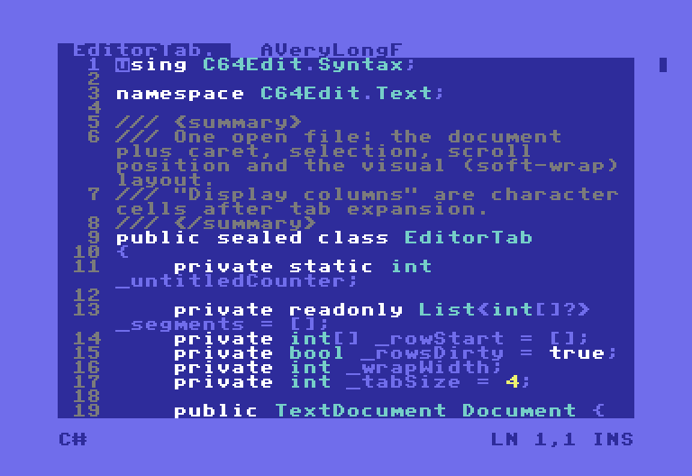
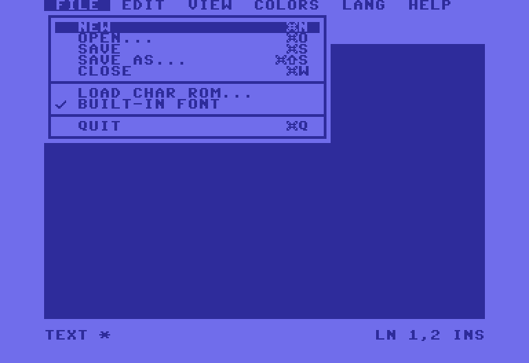
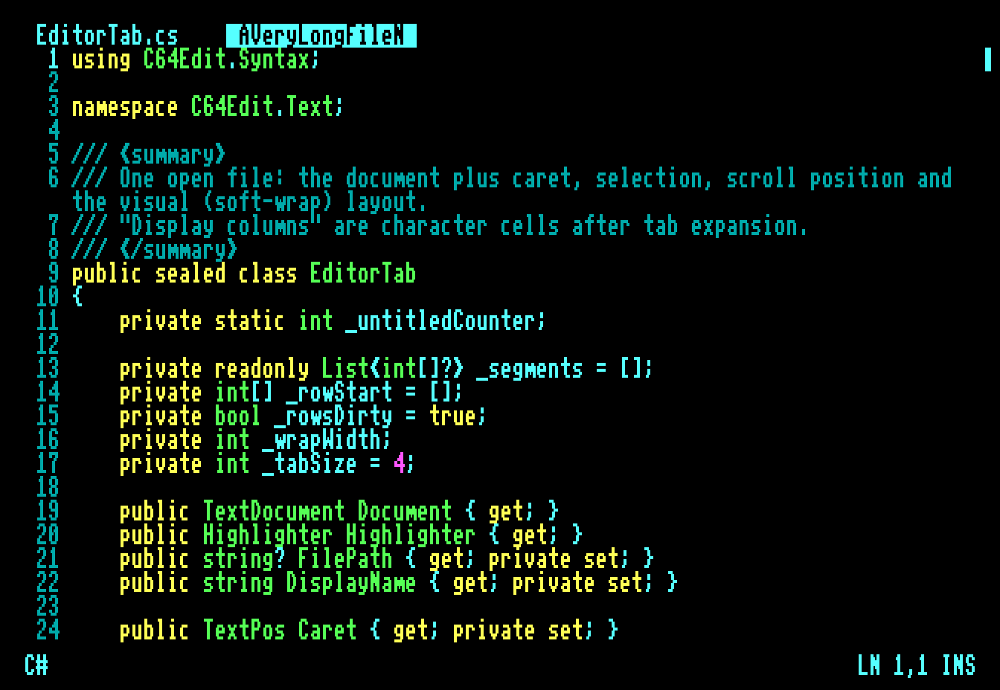

# C64Edit

A modern, cross-platform (Windows, macOS, Linux) text editor wearing a Commodore 64 costume,
built with C# and Avalonia 12.

Everything you see (border, text, tabs, menus, dialogs) is drawn as 8x8 character cells into a
machine-resolution frame buffer and scaled up with nearest-neighbour sampling. That keeps it pixel-sharp.

 



## Run

```bash
dotnet run --project src/C64Edit -- [files...]
```

Requires the .NET 10 SDK. Paths that don't exist yet open as new files that save there.

## Features

- **C64 look:** light-blue border, blue screen, a blinking reverse-video block cursor, a C64-style font, and the boot banner.
- **C128 mode** (View menu): 80x25 with the VDC's RGBI palette and double-height pixels, like a C128 on an 80-column monitor.
- **Window size:** *True size* locks the window to 40x25 (C64) or 80x25 (C128) plus border. *Dynamic* lets you resize
  freely; the glyph size stays fixed and the character grid grows or shrinks. Scale 1x–4x (`Cmd/Ctrl+1..4`).
- **Menu bar** in C64 font. It appears when you tap Alt/Option, press F10, or move the mouse to the top border.
- **Tabs** in the top border, shown only when more than one file is open. Names too long for a tab
  slowly rotate (marquee). Click to switch, middle-click to close, `Ctrl+Tab` to cycle.
- **Syntax highlighting** using only the 16 palette colors: C#, C/C++, Java/Kotlin, JS/TS, Python, Rust, Go,
  JSON, XML/HTML, CSS, shell, PowerShell, SQL, YAML, INI/TOML, Markdown, 6502 assembly and Commodore BASIC.
- **Modern editing:** mouse selection (double-click word, triple-click line), undo/redo, clipboard, smart Home,
  word navigation, auto-indent, block indent/outdent, find/replace (smart case), go to line, soft word wrap,
  line numbers, show whitespace, insert/overwrite, drag and drop files, and unsaved-changes prompts.
- **Colors** menu: cycle the border, screen and text colors (like `POKE 53280`).
- **Fonts:** the built-in font is an original C64-style design (`src/C64Edit/Assets/font8x8.txt`; edit it as ASCII art).
  For pixel-exact Commodore glyphs, use *File → Load Char ROM...* with a `chargen` ROM image you own
  (for example from a VICE installation). Characters a ROM lacks fall back to the built-in font.

Settings are saved to `settings.json` in the user's application-data folder: `~/Library/Application Support/C64Edit`
on macOS, `~/.config/C64Edit` on Linux, `%APPDATA%\C64Edit` on Windows. Unhandled errors are written to `crash.log`
in the same folder (and to the terminal).

## Tests

```bash
dotnet test
```

The UI tests run the real window on Avalonia's headless platform. Set `C64EDIT_SNAPDIR=/some/dir` to also
write PNG snapshots of each scripted step.
